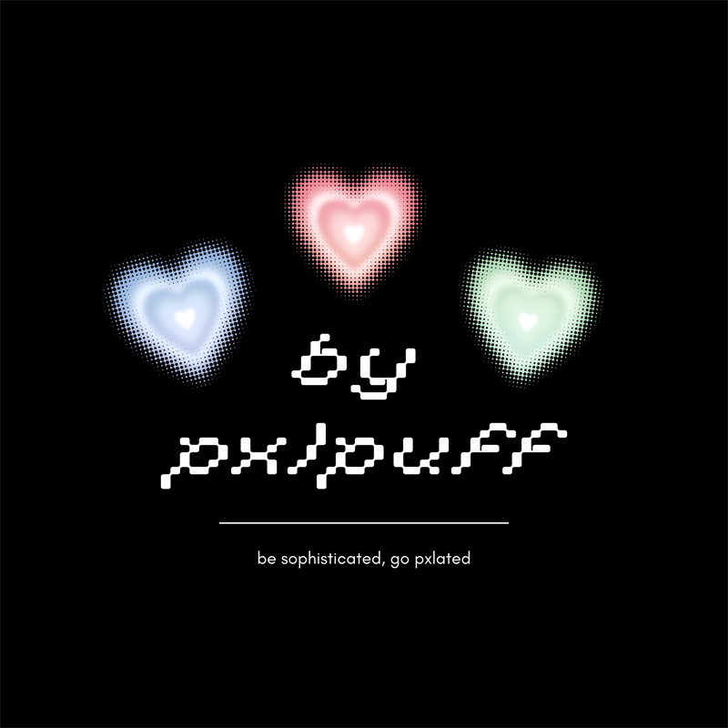
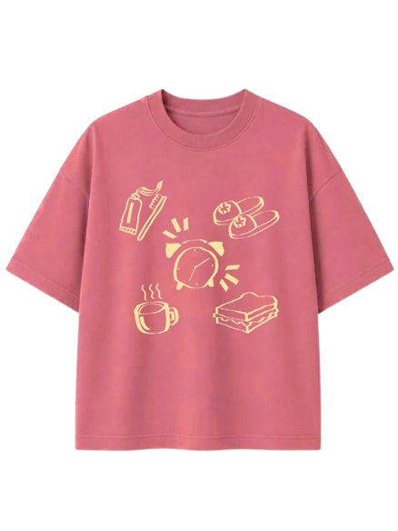
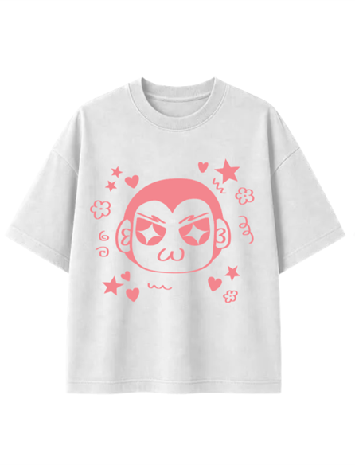
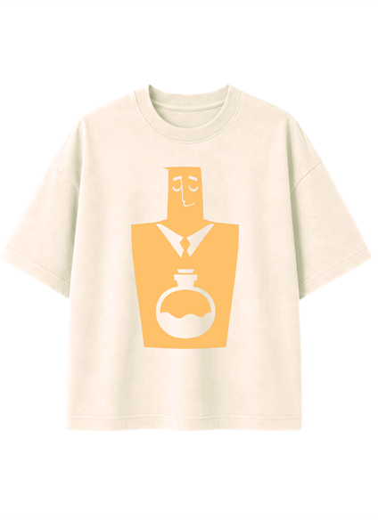

<div align="center">



# by pxlpuff

**be sophisticated, go pxlated.**

An online store for pixel-themed graphic tees, built as a static, Bootstrap-based website.


[Figma mockup](https://www.figma.com/design/NQzZYQi1m4G9I0eHAxFo9I/-by-pxlpuff--Visual-Mockup) ·
[Pages](#pages) ·
[Run it](#run-it-locally) ·
[Status](#project-status)

</div>

---

## The shirts

<table align="center">
  <tr>
    <td align="center"><br><b>Don’t Be Late Tee</b><br>₱ 499</td>
    <td align="center"><br><b>Everyday Comfort Tee</b><br>₱ 499</td>
    <td align="center"><br><b>Do Good Work Tee</b><br>₱ 499</td>
  </tr>
</table>

Each shirt comes in White or Black, with front and back views on its product page.

## About the project

This is the group project for **MMS 142: Internet Technologies and Web Development** (Assignment #2) at the University of the Philippines Open University. The brief: take a client's brand kit and wireframes, design a visual mockup in Figma, and turn it into a responsive, accessible website using Bootstrap, published on GitHub Pages.

The site is built from the Figma file at a 1440px desktop width and scales down for smaller screens. There is no backend, no build step and no JavaScript yet.

## Pages

| Page | File | What it shows |
| --- | --- | --- |
| Home | [`index.html`](index.html) | Hero, "What's New" with three tees, About Us (founder Arabella Tan) |
| Shop | [`shop.html`](shop.html) | All shirts with prices (breadcrumb: Shop > Shirts) |
| Don’t Be Late Tee | [`dont-be-late-tee.html`](dont-be-late-tee.html) | Gallery, price, colour, size, quantity, order, wishlist, description |
| Everyday Comfort Tee | [`everyday-comfort-tee.html`](everyday-comfort-tee.html) | Same layout |
| Do Good Work Tee | [`do-good-work-tee.html`](do-good-work-tee.html) | Same layout |
| Cart | [`cart.html`](cart.html) | Three cart items with "Learn more..." links |
| Wishlist | [`wishlist.html`](wishlist.html) | Saved shirts, each with a remove button |
| Search | [`search.html`](search.html) | Search box and recent search chips |
| Login | [`login.html`](login.html) | Email and password form |
| Register | [`register.html`](register.html) | Sign-up form |
| Contact | [`contact.html`](contact.html) | Facebook, Instagram and email links, newsletter sign-up |
| Privacy Policy | [`privacy-policy.html`](privacy-policy.html) | Policy text with decorative shapes |

## Run it locally

Open `index.html` in a browser, or serve the folder:

```bash
# Python
python -m http.server 8080

# or Node
npx serve .
```

Then visit http://localhost:8080. An internet connection is needed to load Bootstrap and the Google Fonts.

## Project structure

```text
.
├── index.html, shop.html, cart.html, ...   one file per page
├── css/
│   ├── styles.css                          all shared styles
│   └── privacy-shapes.css                  Privacy Policy decorations only
├── images/
│   ├── brand-logo.png                      full logo (used in this README)
│   ├── logo.png, footer-logo.png           header and footer logos
│   ├── hero.png, about.jpg                 home page images
│   ├── icon-facebook.png, icon-instagram.png, icon-email.png
│   └── products/                           per-shirt crops
└── js/                                     empty, reserved for scripts
```

## Design system

### Colours

| Token | Hex | Swatch |
| --- | --- | --- |
| Burgundy | `#A83250` |  |
| Cream | `#F6F0EB` |  |
| Sage | `#A8B89A` |  |
| Blue | `#8FA9BD` |  |
| Soft grey | `#F0F0F0` |  |

### Type

- **Playfair Display** (bold) for headings
- **Poppins** (400 to 700) for body text, buttons and forms

### Figma pixels

`css/styles.css` defines `--p` as one Figma pixel, so a value from Figma is written as `calc(300 * var(--p))`. At 1440px and wider, `--p` is 1px. Below that, the root font size shrinks and everything scales together. Below 900px the layouts stack into a single column.

### Shared layout

- Every page sets a class on `<body>` (`page-home`, `page-cart`, `page-login`, ...) so page-specific rules stay scoped.
- Every page has a header and a black footer with the logo and a Privacy Policy link.

## Product images

Shirt photos are CSS background images applied through `pic-*` classes at the bottom of `css/styles.css`. They are crops of the source images in the Figma file, exported at 2x.

| Used on | File pattern in `images/products/` |
| --- | --- |
| Home | `home-<shirt>.png` |
| Shop and Wishlist | `shop-<shirt>.png` |
| Cart | `cart-<shirt>.png` |
| Product page main image | `<shirt>-main.png` |
| Product page thumbnails | `<shirt>-thumb-1.png` (front), `<shirt>-thumb-2.png` (back) |

When a design changes in Figma, re-export the crops with the same filenames and sizes.

## Accessibility

Following the course's Accessible and Inclusive Design (AID) checklist:

- Pictures are CSS backgrounds, so each has `role="img"` and an `aria-label` (for example "Don’t Be Late Tee, front view") in place of an `alt` attribute.
- Decorative inline SVGs use `aria-hidden="true"`. Icon-only links such as Search and Cart have an `aria-label`.
- Form fields have labels or `aria-label`, and breadcrumbs use `aria-label="Breadcrumb"`.
- Pages use semantic `header`, `nav`, `main` and `footer` elements and a viewport meta tag.

## Project status

| Requirement | Status |
| --- | --- |
| Home, Contact, Privacy Policy and 3 product pages | Done |
| Shared custom CSS linked after Bootstrap | Done |
| Responsive layout (single column under 900px) | Done |
| Lowercase file names in `css`, `js` and `images` folders | Done |
| Alt text and labels for non-text content | Done |
| Same navbar on every page | To do (the home page uses text links, other pages use icon links) |
| Bootstrap JavaScript from the CDN | To do (only the CSS is linked) |
| Contact form opens the email app, addressed to `hello@examplewebsite142.com` | To do (form posts to `#`) |
| Order Now opens the email app with the shirt details, addressed to `orders@examplewebsite142.com` | To do (button links to `cart.html`) |
| Visible keyboard focus on all links and buttons | To do (only form fields have a focus style) |
| Colour contrast check (4.5:1 for normal text) | Not checked |
| Publish with GitHub Pages | Not checked |

Other things that are static for now: the cart, wishlist and recent searches are fixed markup, the size and quantity controls on product pages are display only, and the contact links point to `#`.

## Repository

[github.com/erishiiro/bypxlpuff](https://github.com/erishiiro/bypxlpuff) (branch `main`)
